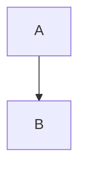

<HTMLBlock>{`

<div>hi</div>
`}</HTMLBlock>

<div>
<HTMLBlock>{`<p>x</p>`}</HTMLBlock>
</div>

<div class="x">
  <p>Para</p>
</div>

<!-- comment -->

<style>{`
.a { color: red; }
`}</style>

```js First
console.log(1);
```

```python Second
print(1)
```



[Video](https://www.youtube.com/watch?v=abc '@embed')

<Embed url="https://www.youtube.com/watch?v=abc" title="Video" typeOfEmbed="youtube" />


<Image src="https://example.com/a.png" alt="Alt" caption="A *caption*" />

<figure>
  
  <figcaption>Cap **b**</figcaption>
</figure>

Text  more
